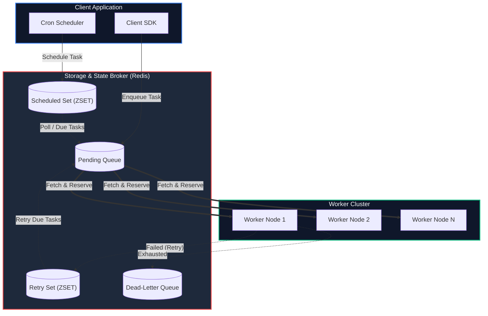

<div align="center">

# ⚡ Asynq: Distributed Task Queue in Go

### *Simple, Reliable, and High-Throughput Distributed Asynchronous Processing Engine Powered by Redis*

[](https://golang.org/)
[](https://redis.io/)
[](LICENSE)
[](https://github.com/Prathamwadiyar/asynq)

---

[Key Features](#-key-features) •
[Architecture](#-system-architecture) •
[Quick Start](#-quick-start) •
[CLI & Dashboard](#-cli--web-dashboard) •
[Documentation](#-documentation) •
[Author](#-author)

</div>

---

## 🚀 Overview

**Asynq** is a robust Go library for queuing tasks and processing them asynchronously in the background with worker nodes. Powered by Redis, Asynq is designed to be lightweight, scalable, and easy to integrate into microservices and distributed Go applications.

Whether you are handling background email dispatches, complex image/video processing pipelines, webhook deliverability, periodic cron jobs, or heavy analytics indexing—Asynq manages task lifecycles with strict atomicity and high performance.

---

## 🔥 Key Features

- ⚡ **Guaranteed At-Least-Once Execution**: Robust task lifecycle state tracking backed by Redis data structures.
- 🎯 **Weighted Priority Queuing**: Multiple task queues with custom priority weightings.
- ⏰ **Scheduled & Deferred Tasks**: Precision scheduling for delayed execution.
- 🔁 **Periodic & Cron Jobs**: Native cron-like job scheduler for recurring background workloads.
- 🔄 **Automatic Retries & Exponential Backoff**: Customizable retry logic with fallback dead-letter queue (DLQ) storage.
- 📊 **Real-Time Monitoring**: CLI dashboard and Prometheus metrics exporter built-in.
- 🛡️ **Unique Task De-duplication**: Lock-based deduplication window to prevent redundant processing.
- 🔀 **Task Aggregation & Batching**: Batch multiple related tasks together before dispatching to workers.
- 🛑 **Graceful Shutdown & Signal Handling**: Clean worker teardown ensuring zero task loss during deployments.

---

## 🏗️ System Architecture



---

## ⚡ Quick Start

### 1. Installation

```bash
go get -u github.com/Prathamwadiyar/asynq
```

### 2. Enqueueing a Task (Client)

```go
package main

import (
	"encoding/json"
	"log"
	"time"

	"github.com/Prathamwadiyar/asynq"
)

type EmailPayload struct {
	UserID  int    `json:"user_id"`
	Message string `json:"message"`
}

func main() {
	client := asynq.NewClient(asynq.RedisClientOpt{Addr: "localhost:6379"})
	defer client.Close()

	payload, _ := json.Marshal(EmailPayload{UserID: 42, Message: "Welcome to Asynq!"})
	task := asynq.NewTask("email:welcome", payload)

	// Process immediately or schedule after 10 minutes
	info, err := client.Enqueue(task, asynq.ProcessIn(10*time.Minute), asynq.MaxRetry(5))
	if err != nil {
		log.Fatalf("Could not enqueue task: %v", err)
	}
	log.Printf("Enqueued task: ID=%s Queue=%s", info.ID, info.Queue)
}
```

### 3. Processing Tasks (Server Worker)

```go
package main

import (
	"context"
	"encoding/json"
	"fmt"
	"log"

	"github.com/Prathamwadiyar/asynq"
)

func handleWelcomeEmail(ctx context.Context, t *asynq.Task) error {
	var p struct {
		UserID  int    `json:"user_id"`
		Message string `json:"message"`
	}
	if err := json.Unmarshal(t.Payload(), &p); err != nil {
		return fmt.Errorf("json.Unmarshal failed: %v", err)
	}
	log.Printf("Sending email to User %d: %s", p.UserID, p.Message)
	return nil
}

func main() {
	srv := asynq.NewServer(
		asynq.RedisClientOpt{Addr: "localhost:6379"},
		asynq.Config{
			Concurrency: 10,
			Queues: map[string]int{
				"critical": 6,
				"default":  3,
				"low":      1,
			},
		},
	)

	mux := asynq.NewServeMux()
	mux.HandleFunc("email:welcome", handleWelcomeEmail)

	if err := srv.Run(mux); err != nil {
		log.Fatalf("Could not run server: %v", err)
	}
}
```

---

## 🖥️ CLI & Web Dashboard

Asynq comes with a command-line tool `asynq` to inspect queue health, pause/resume queues, and manage archived tasks.

### Install CLI
```bash
go install github.com/Prathamwadiyar/asynq/tools/asynq@latest
```

### Run Terminal Dashboard
```bash
asynq dash
```

---

## 📖 Documentation & References

- 📘 **[Asynq Wiki & Guides](docs/)**
- ⚙️ **[Configuration Reference](docs/asynq_config.md)**
- 📊 **[Prometheus Metrics Exporter](x/metrics/)**
- 🔒 **[Rate Limiting Extensions](x/rate/)**

---

## 👤 Author

Developed & Maintained by **Pratham Wadiyar**

- **GitHub:** [@Prathamwadiyar](https://github.com/Prathamwadiyar)
- **Repository:** [Prathamwadiyar/asynq](https://github.com/Prathamwadiyar/asynq)

---

<div align="center">
  <sub>Licensed under the <a href="LICENSE">MIT License</a>.</sub>
</div>
